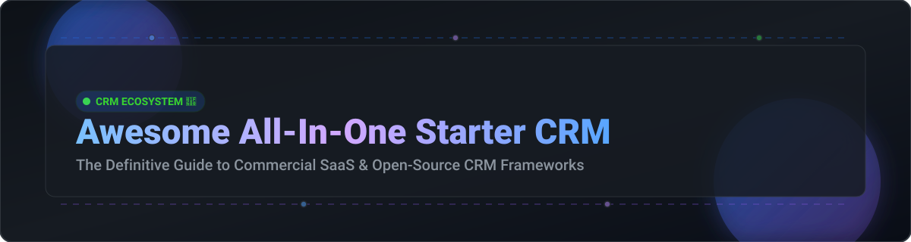

# Awesome-All-In-One-Starter-CRM

# Awesome-All-In-One-Starter-CRM 🚀 🤝

  

  
  
  
  
  
  

---

## 🌟 Top All-in-One Starter CRM Ecosystem

**Curated List of Commercial Starter CRM Platforms & Open-Source CRM Frameworks**  
*Focused on Contact Management, Sales Pipeline, Email Integration, Lightweight Automation & Self-Hosted CRM for Small Teams*

**Last updated: October 2026** 📅

---

### 📌 Overview & SEO Summary
Welcome to the ultimate curated directory of **all-in-one starter CRM platforms**, **open-source CRM frameworks**, and **lightweight relationship management tools**. Whether you are looking for affordable commercial solutions (such as *Salesforce Starter Suite*, *HubSpot Starter*, and *Bigin by Zoho*), or self-hostable open-source alternatives (like *EspoCRM*, *SuiteCRM*, and *Capsule CRM's open-source roots*), this list covers category leaders, pipeline management, and privacy-respecting small business CRM.

**Key Market Context:**
- **Salesforce Starter Suite** starts at **$25/user/month** with **transaction fees applying** — no annual contract required, unlike the higher Pro Suite tier [citation:1][citation:12].
- **HubSpot Starter** is normally **$20/month per seat** but is currently offering **up to 65% off for new customers** — **$7/seat/month annual** or **$10/seat/month monthly** [citation:13].
- **Bigin by Zoho** is the **most affordable paid starter CRM** at **$7/user/month** (annual), with **AI tools included from Premier at $12/user/month** and **no setup fees** [citation:19].
- **Zoho One** (all-in-one suite) costs **$37/user/month** and **replaces 8+ tools**, with a **TCO calculator showing $136,200/year savings** for a 50-person team [citation:3].
- **Less Annoying CRM** offers **one price tier at $15/user/month** with **no onboarding fees, no setup consultants, and no annual lock-in** [citation:7].
- **Capsule CRM** offers a **free forever plan** (250 contacts, 2 users) and **paid plans** with **AI pipeline generation and enrichment** [citation:6].

---

## 📑 Table of Contents
- [🏢 SaaS & Commercial Platforms](#-saas--commercial-platforms)
- [🔓 Open-Source GitHub Projects](#-open-source-github-projects)
- [🛠️ How to Contribute](#%EF%B8%8F-how-to-contribute)
- [📊 Star History](#-star-history)
- [🤝 Support & Sponsorship](#-support--sponsorship)
- [⚠️ Disclaimer](#%EF%B8%8F-disclaimer)

---

## 🏢 SaaS / Commercial Platforms

The all-in-one starter CRM market spans **CRM-led suites** (Salesforce Starter Suite, Zoho One) that bundle **sales, marketing, and support into one platform**, **inbound-first platforms** (HubSpot Starter) that excel at **email marketing and lead nurturing**, and **affordable sales-focused tools** (Bigin, Less Annoying CRM) that prioritize **simplicity and price predictability**. **Salesforce Starter Suite** starts at **$25/user/month** with transaction fees [citation:1]. **HubSpot Starter** is **$7–$10/seat/month** (discounted) or **$20/seat/month** at list price [citation:13]. **Bigin by Zoho** is **$7/user/month** (annual) [citation:19]. **Less Annoying CRM** is **$15/user/month** with no hidden costs [citation:7].

| SaaS / Commercial Platform | Company / Owner | Valuation / Market Cap | Standard Edition Starting Price | Free Tier / Free Trial Limits | Description |
| :--- | :--- | :--- | :--- | :--- | :--- |
| **[Salesforce Starter Suite](https://www.salesforce.com/getting-started/intro/)** ☁️ | Salesforce | ~$250 Billion | **$25/user/month** (billed monthly or annually) [citation:1] | **No free tier**; free trial available | **Enterprise-grade starter CRM** — **Everything in Free plus unlimited users, built-in sales process, dynamic email nurturing, and secure payment links** [citation:1]. **Transaction fees apply** [citation:1]. **No annual contract required** — billed monthly or annually [citation:12]. |
| **[HubSpot Starter](https://www.hubspot.com/products/crm/starter)** 🟠 | HubSpot | ~$30 Billion | **$7/seat/month** (annual, discounted); **$10/seat/month** (monthly, discounted); **$20/seat/month** (list) [citation:13] | **Free tier: generous, with 2 users** | **Inbound-first starter CRM** — **Unlocks higher usage limits, additional features, and removal of HubSpot branding** [citation:13]. **Includes 1,000 contacts, full CRM with custom properties, and unlimited users (seats purchased per user)** [citation:13]. **500 AI credits per month included** [citation:13]. |
| **[Bigin by Zoho](https://www.bigin.com/)** 🟢 | Zoho Corporation | Private | **$7/user/month** (Express, annual) [citation:19] | **Free: 1 user with customizable pipeline, IVR, 3 automations** [citation:19] | **Simple starter CRM for small teams** — **Paid plans start at $7/user/month** [citation:19]. **Premier at $12/user/month includes full AI toolkit: writing assistant, email reply suggestions, record summaries, cross-sell suggestions, and churn alerts** [citation:19]. **Bigin 360 at $18/user/month** adds 15 team pipelines, 1M records, and 3,000 AI credits [citation:19]. **Money-back guarantee: 30 days monthly, 45 days annual** [citation:19]. |
| **[Zoho One](https://www.zoho.com/one/)** 🏢 | Zoho Corporation | Private | **$37/user/month** (All-Employee plan, annual) [citation:3] | **30-day free trial, no credit card required** [citation:3] | **All-in-one business operating system** — **50+ integrated apps across sales, marketing, support, finance, HR, and operations** [citation:3]. **TCO calculator shows $136,200/year software savings for a 50-person team** [citation:3]. **Reduced training costs, eliminated integration maintenance, and better data accuracy** [citation:3]. |
| **[Pipedrive Essential](https://www.pipedrive.com/)** 🎯 | Pipedrive | Private | **Custom pricing** | **Free trial available** | **Sales-focused starter CRM** — **Straightforward pipeline interface** [citation:10]. **Base tier lacks automations and integrations** [citation:10]. **Price increases quickly as you scale**. |
| **[Freshsales Starter](https://www.freshworks.com/freshsales-crm/)** 🔵 | Freshworks | ~$3 Billion | **Custom pricing** | **Free tier available** | **Affordable starter CRM** — **Cheapest advertised CRM at every team size** [citation:4]. **Freshsales Growth wins on sticker price, but Zoho wins on total value at 25+ seats** [citation:4]. |
| **[Copper Basic](https://www.copper.com/)** 🟣 | Copper | Private | **$23/seat/month** (Basic, annual); **$29/seat/month** (monthly) [citation:5] | **Free trial available** | **Google Workspace-native CRM** — **Starter at $9/seat/month (annual) with 1,000 contacts** [citation:16]. **Basic at $23/seat/month adds task automation, pipelines, project management, and contact enrichment** [citation:16]. **Deep Gmail integration** [citation:5]. |
| **[Capsule CRM](https://capsulecrm.com/)** 🟤 | Capsule CRM | Private | **Paid plans** (Starter, Growth, Advanced) [citation:6] | **Free forever: 250 contacts, 2 users, 1 pipeline** [citation:6] | **Simple starter CRM** — **Free plan includes 250 contacts, 5 custom fields, 1 sales pipeline, and Outlook/Gmail add-in** [citation:6]. **Starter adds 30,000 contacts, email templates, shared mailbox, and basic reporting** [citation:6]. **Growth adds workflow automations, multiple pipelines, and AI business enrichment** [citation:6]. **Advanced adds custom sales milestones and advanced mail connection** [citation:6]. |
| **[Less Annoying CRM](https://lessannoyingcrm.com/)** 🟡 | Less Annoying CRM | Private | **$15/user/month** (no contracts, no tiers) [citation:7] | **Free trial: every user free on day one** [citation:7] | **Simple, honest starter CRM** — **One price tier with no setup fees, no onboarding consultants, and no annual lock-in** [citation:7]. **Family-owned and self-funded since 2009** [citation:7]. **Free human support for everyone, always** [citation:7]. |
| **[Streak CRM](https://www.streak.com/)** 🔴 | Streak | Private | **$20/user/month** (Pro) [citation:9] | **Free tier available** | **Gmail-native starter CRM** — **CRM directly inside Gmail** [citation:9]. **AI features: autofill deal data, deal summaries, deal Q&A, and pipeline creator** [citation:9]. **Google Workspace integrations with Gmail, Calendar, Drive, Sheets, and Chat** [citation:9]. **Zapier integration with 9,000+ apps** [citation:9]. |

---

## 🔓 Open-Source GitHub Projects

*Sorted by GitHub_Stars_Count (Descending)* 🌟

- **[SuiteCRM](https://github.com/salesagility/SuiteCRM)**   
  **Award-winning enterprise-class open-source CRM**, AGPL-3.0 licensed. **The successor to SugarCRM Community Edition** — **large user base and many features** [citation:10]. **Workflow automation, modularity, reporting tools, security suite, and customization framework** [citation:10]. **Limitations: outdated codebase, poor user experience, dated design, limited REST API, clunky reports, and subpar mobile UI** [citation:10]. **Best for organizations that need feature breadth and have technical resources to manage legacy code**. 🏛️

- **[EspoCRM](https://github.com/espocrm/espocrm)**   
  **Open-source CRM with SPA frontend and REST API**, AGPL-3.0 licensed. **Very complete CRM with a clean user interface designed for productivity** [citation:10]. **Powerful in-app administration allows you to customize pretty much everything** [citation:10]. **Roles manager, audit log, email sync, OIDC/LDAP, and rich library of paid extensions** [citation:10]. **Limitations: large codebase, homemade backend and frontend frameworks, limited documentation, and no AI-powered features** [citation:10]. **Best for SMBs that need a complete, customizable CRM and have development resources**. 🎯

- **[Frappe CRM](https://github.com/frappe/crm)**   
  **Fully featured, modern CRM**, MIT licensed. **Built on the Frappe framework** — **modern architecture with Python backend and Vue.js frontend**. **Part of the ERPNext ecosystem** — **integrates seamlessly with ERPNext's accounting, inventory, and HR modules**. **The most modern open-source CRM architecture**. 🚀

- **[Twenty](https://github.com/twentyhq/twenty)**   
  **Modern CRM with the flexibility of open source**, AGPL-3.0 licensed. **TypeScript-based** — **built with modern web technologies**. **Designed as a flexible, customizable CRM** for teams that want to build their own workflows. **The most modern TypeScript-native open-source CRM**. ⚡

- **[ERPNext](https://github.com/frappe/erpnext)**   
  **All-in-one ERP with robust CRM capabilities**, GPL-3.0 licensed. **The most complete open-source business management platform** — **CRM, accounting, inventory, HR, manufacturing, and more**. **Best for SMBs that need CRM as part of a broader ERP system**. 🏢

- **[Dolibarr](https://github.com/Dolibarr/dolibarr)**   
  **Modular ERP and CRM for SMEs**, GPL-3.0 licensed. **Designed specifically for small and medium-sized businesses**. **Modular architecture lets you enable only the features you need** — **CRM, invoicing, inventory, and project management**. **The most SMB-friendly open-source ERP/CRM**. 📦

- **[YetiForce](https://github.com/YetiForceCompany/YetiForceCRM)**   
  **Feature-rich CRM with 100+ built-in modules**, open-source. **One of the most innovative CRM systems that supports business processes and allows for customization according to your needs** [citation:10]. **100+ built-in modules** cover nearly every business scenario. **Best for organizations that need extensive out-of-the-box functionality**. ⚙️

- **[OroCRM](https://github.com/oroinc/crm-application)**   
  **Flexible CRM for marketing, sales, and customer service**, OSL-3.0 licensed. **Built on Symfony framework** — **strong test coverage and comprehensive developer documentation** [citation:10]. **Great user documentation, automated actions, email sync, and custom fields** [citation:10]. **Limitations: outdated frontend stack, complex initial setup, steep learning curve, and no mobile app** [citation:10]. **Best for B2B eCommerce companies that need CRM integrated with commerce**. 🏗️

- **[Krayin](https://github.com/krayin/laravel-crm)**   
  **Low-code CRM with enterprise-grade features**, MIT licensed. **Laravel-based** — **designed for businesses that want a modern, low-code CRM**. **The most accessible Laravel-based open-source CRM**. 🛠️

- **[1CRM](https://github.com/1CRM/1CRM)**   
  **Flexible CRM for sales, marketing, and customer service**, open-source. **Available self-hosted (open-source) or as a cloud solution** [citation:10]. **360-degree view of customers, own PDF and module designer, project management linked to CRM data, integrated contract management, and REST API** [citation:10]. **Starts at €17/user/month, Enterprise at €55/user/month** [citation:10]. **Best for mid-sized businesses that want a central control center for their entire company**. 🎛️

- **[Django-CRM](https://github.com/MicroPyramid/Django-CRM)**   
  **CRM for startups with sales pipeline management**, MIT licensed. **Django-based** — **analytical CRM with task management and email marketing**. **Designed for easy customization and quick development**. **The most Pythonic open-source CRM**. 🐍

- **[DaybydayCRM](https://github.com/Bottelet/DaybydayCRM)**   
  **Open-source CRM to help you keep track of your daily workflow**, MIT licensed. **Track daily workflow with leads, tasks, and clients**. **PHP/Laravel-based** — **lightweight and focused**. **Best for solopreneurs and very small teams**. 📅

---

## 🛠️ How to Contribute

Contributions are welcome! Follow these steps to submit new starter CRM platforms or open-source CRM software:

1. 🍴 **Fork** the repository.
2. 📝 **Add/edit** entries in `README.md` maintaining table/list structure and formatting.
3. 🔗 Include project title, official website/GitHub link, exact Stars_Count, license, and brief description.
4. 🚀 Submit a **Pull Request** with a descriptive summary of your changes.

---

## 📊 Star History

---

## 🤝 Support & Sponsorship

If you find this all-in-one starter CRM repository useful, please consider supporting the project:

- ⭐ **Star** this repository to increase visibility!
- 🔀 **Fork** and share with fellow small business owners, sales leaders, and open-source advocates.
- ☕ **Sponsor & Buy Me a Coffee**: Support ongoing open-source curation via the [GitHub Sponsor Dashboard](https://github.com/sponsors/ishandutta2007).

---

## ⚠️ Disclaimer

- This is a **community-curated** list — not exhaustive and not an endorsement. ℹ️
- **Salesforce Starter Suite charges transaction fees on top of the $25/user/month price** [citation:1]. **HubSpot's discounted pricing is for new customers only** — list price is **$20/seat/month** [citation:13]. **Bigin's AI tools are only included from Premier at $12/user/month** [citation:19].
- **Zoho One at $37/user/month replaces 8+ tools** for a 50-person team, with **$136,200/year in software savings** according to their TCO calculator [citation:3]. **This is the best all-in-one value for teams that can commit to the Zoho ecosystem**.
- **Open-source CRM is not free** — **SuiteCRM and EspoCRM have zero license cost** but **require technical expertise to deploy, customize, and maintain**. **EspoCRM lacks AI-powered features** [citation:10]. **SuiteCRM has an outdated codebase and dated design** [citation:10]. **For very small organizations without technical staff, a SaaS starter CRM may be cheaper in practice**.
- **Always validate CRM fit with a free trial** — **test with colleagues from different departments** to see how it works across situations. **Less Annoying CRM offers no annual lock-in, so you can start small and grow** [citation:7]. 🤝

---

  <b>Made with ❤️ for small business owners, sales leaders, and open-source CRM advocates.</b>

